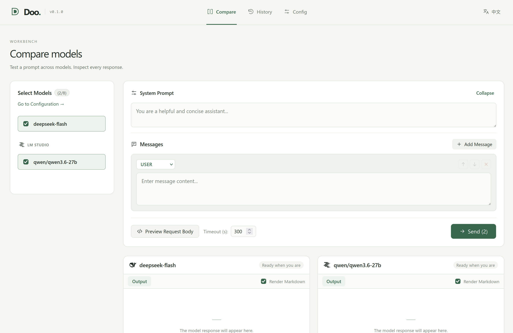

# Doo

Doo is a local web tool for LLM benchmark pilots: comparing models' capabilities with the same prompts.

It ships as a **single, self-contained binary**, about **12.5 MB on Linux x86-64**, including the web UI and SQLite.

<p align="center"><em>My three-year-old daughter loves Baby Shark Dance. The “Doo-doo” in the song gave this project its name.</em></p>



## Why Doo?

Doo is built for LLM benchmark pilots. Send the same prompt to multiple models and compare their capabilities before running a full benchmark.

[Cherry Studio](https://www.cherryai.com/docs/en/cherrystudio/preview/) is aimed at using LLMs for real work. For my own work, I prefer tools such as Codex and Claude Code.

Compare responses side by side, inspect requests, and check latency and token usage. Export requests as curl or Python to reuse in benchmark scripts.

## Quick Start

### Download a Release

The easiest way to get started is to download a prebuilt binary from the [latest release](https://github.com/ChenZhongPu/Doo/releases/latest). Choose the archive for your operating system and processor.

Extract the archive and open a terminal in the extracted folder. On macOS or Linux, run:

```bash
./doo
```

On Windows, run from PowerShell:

```powershell
.\doo.exe
```

Doo opens your browser at [localhost:8787](http://localhost:8787). Add a provider and a model preset under **Config**, then select models and send a prompt under **Compare**. Settings and run history are stored in `~/.doo` by default.

### Build from Source

To build it yourself, install Go 1.26 or later, Node.js 18 or later, npm, and Make. From the repository root:

```bash
npm --prefix web ci
make all
./bin/doo
```

The executable is written to `bin/doo`.

### Command-line Options

For example, to use another port and data directory:

```bash
./doo --addr 127.0.0.1:9000 --data ./doo-data
```

| Flag | Default | Description |
|---|---|---|
| `--addr` | Unset | Override `--host` and `--port` with a listen address (`host:port`) |
| `--host` | `localhost` | Server listen host |
| `--port` | `8787` | Server listen port |
| `--data` | `~/.doo` | Data directory storing `doo.db` and `master.key` |
| `--max-targets` | `8` | Maximum concurrent targets in comparison (`0` for unlimited) |
| `--open` | `true` | Automatically open default browser on launch |
| `--version` | `false` | Print version information and exit |

### Manage Run History

History shows up to 100 runs per page. Use the page controls to browse older records or **Delete all** to clear every page after confirmation.

You can also delete history from the command line without starting the server:

```bash
./doo history delete --before 2026-10-01 --dry-run
./doo history delete --before 2026-10-01
./doo history delete --id 12,15,19
./doo history delete --keep-last 100
./doo history delete --all
```

Choose exactly one deletion option. `--before YYYY-MM-DD` deletes runs created before midnight on that date in your local time zone; it keeps that date and later dates. Run IDs are shown on the cards in History. `--keep-last N` retains the latest N runs by run ID. Add `--dry-run` to preview the matching count, or `--data /path/to/doo-data` to use another data directory. Deleting a run also removes its saved requests, responses, and metrics. Providers, model presets, and credentials are preserved.
